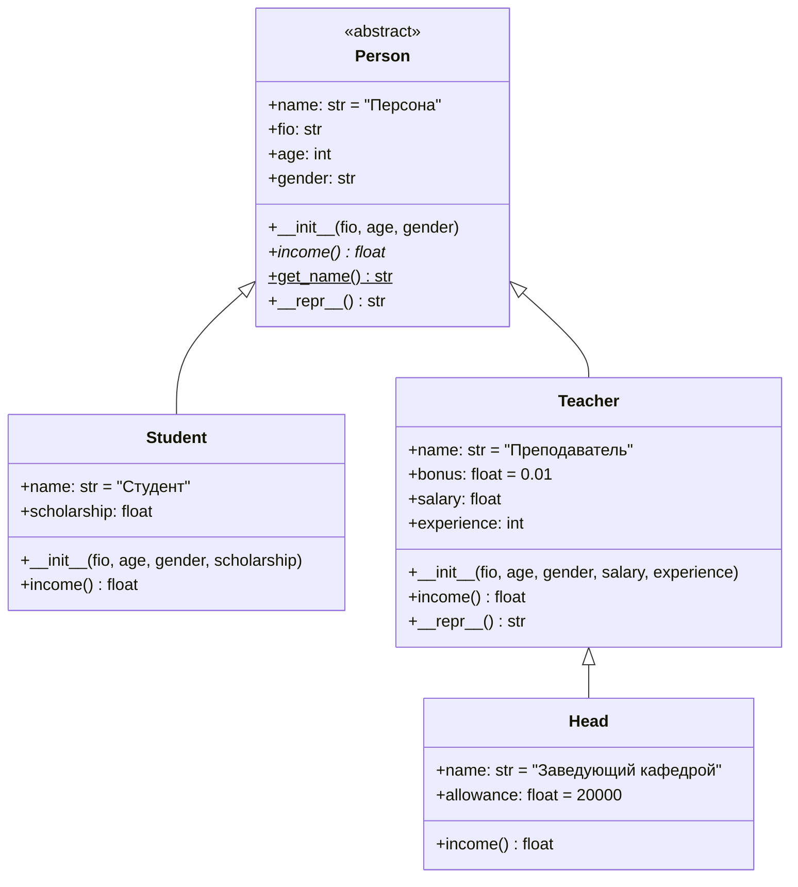

<div align="center">

Московский государственный технический университет им. Н. Э. Баумана

Факультет «Инженерный бизнес и менеджмент» (ИБМ) · Кафедра ИБМ3

<br>

# Отчёт по лабораторной работе №2

## «Объектно-ориентированные возможности языка Python»

Вариант 20

<br>

| | |
|---|---|
| Выполнил | студент группы ИБМ3-34Б Сергеев Д. |
| Проверил | Бурмистрова М. В. |

Москва, 2026

</div>

---

## Цель работы

Изучение объектно-ориентированных возможностей языка Python.

## Описание задания

1. Создать виртуальное окружение и установить в него хотя бы один внешний пакет с помощью `pip install <пакет>`.
2. Разработать программу, реализующую работу с классами, в виде консольного приложения на Python 3.
3. Все файлы проекта (кроме основного файла `main.py`) должны располагаться в пакете `lab_python_oop`.
4. Каждый класс должен располагаться в отдельном файле пакета `lab_python_oop`.

**Вариант 20.** Написать программу, в которой описана иерархия классов: персона (студент, преподаватель, заведующий кафедрой). Базовый класс должен иметь поля для хранения ФИО, возраста, пола, а также методы получения среднего дохода в денежном эквиваленте (имеет надбавку за выслугу лет).

### Диаграмма классов



Обозначения: «abstract» — абстрактный класс, курсив — абстрактный метод (`@abstractmethod`), подчёркивание — метод класса (`@classmethod`), стрелка с треугольником — наследование (от потомка к родителю).

| Класс | Файл | Средний доход |
|---|---|---|
| `Person` | `person.py` | абстрактный метод `income()` |
| `Student` | `student.py` | стипендия |
| `Teacher` | `teacher.py` | оклад × (1 + 1% × стаж) — надбавка за выслугу лет |
| `Head` | `head.py` | доход преподавателя + 20 000 руб. доплаты за руководство |

## Виртуальное окружение и зависимости

### Создание и активация окружения

```bash
cd ~/Desktop/lab2_persons
python3 -m venv venv
source venv/bin/activate
```

### Установка внешнего пакета

```console
(venv) $ pip install tabulate
Collecting tabulate
  Downloading tabulate-0.10.0-py3-none-any.whl (39 kB)
Installing collected packages: tabulate
Successfully installed tabulate-0.10.0
```

### Вывод `pip show tabulate`

```console
(venv) $ pip show tabulate
Name: tabulate
Version: 0.10.0
Summary: Pretty-print tabular data
Home-page: 
Author: 
Author-email: Sergey Astanin <s.astanin@gmail.com>
License: 
Location: /Users/daniil/Desktop/lab2_persons/venv/lib/python3.11/site-packages
Requires: 
Required-by:
```

### Содержимое `requirements.txt`

Файл получен командой `pip freeze > requirements.txt`:

```
tabulate==0.10.0
```

Установить зависимости на другом компьютере: `pip install -r requirements.txt`.

## Текст программы

### `lab_python_oop/__init__.py`

```python
# пустой файл: делает папку пакетом
```

### `lab_python_oop/person.py`

```python
from abc import ABC, abstractmethod


class Person(ABC):
    name = "Персона"

    def __init__(self, fio, age, gender):
        self.fio = fio
        self.age = age
        self.gender = gender

    @abstractmethod
    def income(self):
        pass

    @classmethod
    def get_name(cls):
        return cls.name

    def __repr__(self):
        return "{}: {}, возраст {}, пол {}".format(
            self.get_name(), self.fio, self.age, self.gender
        )
```

### `lab_python_oop/student.py`

```python
from lab_python_oop.person import Person


class Student(Person):
    name = "Студент"

    def __init__(self, fio, age, gender, scholarship):
        super().__init__(fio, age, gender)
        self.scholarship = scholarship  

    def income(self):
        return self.scholarship
```

### `lab_python_oop/teacher.py`

```python
from lab_python_oop.person import Person


class Teacher(Person):
    name = "Преподаватель"
    bonus = 0.01  

    def __init__(self, fio, age, gender, salary, experience):
        super().__init__(fio, age, gender)
        self.salary = salary          
        self.experience = experience  
    def income(self):
        return self.salary * (1 + self.bonus * self.experience)

    def __repr__(self):
        return "{}, стаж {} лет".format(super().__repr__(), self.experience)
```

### `lab_python_oop/head.py`

```python
from lab_python_oop.teacher import Teacher


class Head(Teacher):
    name = "Заведующий кафедрой"
    allowance = 20000  

    def income(self):
        return super().income() + self.allowance
```

### `main.py`

```python
from tabulate import tabulate

from lab_python_oop.student import Student
from lab_python_oop.teacher import Teacher
from lab_python_oop.head import Head


def main():
    student = Student("Иванов Иван Иванович", 20, "м", 5000)
    teacher = Teacher("Петрова Мария Сергеевна", 45, "ж", 60000, 15)
    head = Head("Сидоров Алексей Петрович", 55, "м", 80000, 25)

    print(student)
    print(teacher)
    print(head)
    print()

    table = [
        [student.get_name(), student.fio, student.income()],
        [teacher.get_name(), teacher.fio, teacher.income()],
        [head.get_name(), head.fio, head.income()],
    ]
    headers = ["Должность", "ФИО", "Средний доход, руб."]

    print(tabulate(table, headers=headers, floatfmt=".2f"))


if __name__ == "__main__":
    main()
```

## Экранные формы

Запуск программы в виртуальном окружении:

```console
(venv) $ python main.py
Студент: Иванов Иван Иванович, возраст 20, пол м
Преподаватель: Петрова Мария Сергеевна, возраст 45, пол ж, стаж 15 лет
Заведующий кафедрой: Сидоров Алексей Петрович, возраст 55, пол м, стаж 25 лет

Должность            ФИО                         Средний доход, руб.
-------------------  ------------------------  ---------------------
Студент              Иванов Иван Иванович                    5000.00
Преподаватель        Петрова Мария Сергеевна                69000.00
Заведующий кафедрой  Сидоров Алексей Петрович              120000.00
```

Нижняя часть вывода — таблица, сформированная внешним пакетом `tabulate` (функция `tabulate()` с параметром `floatfmt=".2f"`).

## Вывод

В ходе работы изучены объектно-ориентированные возможности Python: абстрактные классы (`abc.ABC`, `@abstractmethod`), наследование, в том числе многоуровневое (`Head` → `Teacher` → `Person`), вызов методов родителя через `super()`, полиморфизм (метод `income()`), методы класса (`@classmethod`) и магический метод `__repr__`. Классы оформлены в виде пакета `lab_python_oop`. Создано виртуальное окружение, в него установлен внешний пакет `tabulate`, зависимости зафиксированы в `requirements.txt`.
